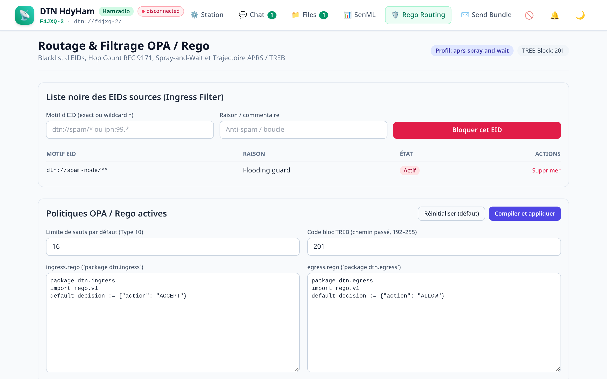

# dtnpm-mod-rego-routing

Declarative **OPA / Rego** extension module (powered by [`regorus`](https://crates.io/crates/regorus)) for **DTN Postmaster (`dtnpm`)** and **Hardy BPA**.

## Screenshot



## Features

- **Ingress Filtering via EID Blacklist**: exact match (`dtn://spam/app`) and wildcard patterns (`dtn://spam/*`, `ipn:99.*`), silent drop without status report (anti-amplification), and real-time CRUD management via REST API / WebUI / SQLite.
- **Hop Count Block (Type 10) & Storm Prevention (RFC 9171 §4.3.3 & §5.3 Step 1)**: priority for local delivery (`DELIVER_LOCAL`), conservative check `(hop_count + 1) >= hop_limit`, bounded anti-duplicate cache (`seen_cache`), and loop guard.
- **Spray-and-Wait Foundations & Custom Extension Blocks**:
  - Support for **Block Type 200** (`replication_control` from `mesh-algo-extension-block.cddl`) and **Block Type 194** (`u32` quota compatible with ION-DTN / Hardy `main-dtnpm`).
  - Generic decoding of any unknown/experimental CBOR extension block to JSON (`helpers.get_custom_block(input.bundle, block_type)`).
  - Egress rewriting (`MUTATE_SPRAY_QUOTA` in binary $\lfloor L/2 \rfloor$ or source mode) and `RegoRoutingAgent` using `RouteAction::ForwardReplicate` (storage retention in Hardy `main-dtnpm`).
- **APRS Routing (Future Path) & TREB (Past Path)**:
  - **Future Path**: Block Type 200 `trajectory_control` (`strict_target`, `scoped_alias` e.g., `WIDE1-1`, `WIDE2-2`), Dire Wolf rules 6.1(b), 6.2(a), 6.3(a), 6.3(c) and excessive alias trapping (`WIDE3+`), emitting `route_key`.
  - **Past Path (TREB — `draft-koo-dtn-traceroute-eb`)**: configurable experimental block (default `201`) recording traversed hops (`node_eid`, `arrival_time_ms`, `departure_time_ms`, `cla_info`) for auditing and loop detection (`has_visited_node`).
- **User Override of Rego Policies**: embedded default policies, override via external `.rego` files (`--policy-dir`), or hot-editing via WebUI (`PUT /api/rego_routing/v1/policy`).

## REST API (`/api/rego_routing/v1`)

- `GET /blacklist`, `POST /blacklist`, `PATCH /blacklist/{id}`, `DELETE /blacklist/{id}`
- `GET /policy`, `PUT /policy`
- `GET /decisions`, `POST /decisions/clear`

## Verification

```bash
./scripts/install-hooks.sh
./scripts/check-security.sh --strict
cargo test --offline --all-targets
```
